# terminal-readme

Generate an animated terminal window as a single SVG for your GitHub profile README. You describe the commands and
their output in a JSON file, the script writes `terminal.svg`. No dependencies, no external services, nothing that
can break later: GitHub just shows an image.

Commands are typed one by one, the output appears line by line and a cursor blinks at the end. Visitors with
"reduce motion" turned on see the finished terminal right away.

## Preview

<p align="center">
  
</p>

Generated from [`examples/grawty.json`](examples/grawty.json).

## Use it

1. Use this repo as a template or clone it.
2. Edit `terminal-readme.config.json` (or copy one from `examples/`).
3. Build:

   ```bash
   node src/cli.js terminal-readme.config.json terminal.svg
   ```

4. Put `terminal.svg` in your profile repository (the one named exactly like your username) next to the README and
   reference it:

   ```markdown
   <p align="center">
     
   </p>
   ```

Needs Node 18 or newer. GitHub caches images, so after replacing the file do a hard refresh (Ctrl+F5).

## Config

```json
{
  "title": "you@localhost: ~",
  "theme": "dark",
  "steps": [
    { "command": "whoami", "output": ["Mete"] }
  ]
}
```

| Key | Default | |
|---|---|---|
| `steps` | required | Commands to type, each with an optional `output` list |
| `title` | `user@host: ~` | Text in the window bar |
| `theme` | `dark` | `dark` or `light` |
| `width` | `760` | Window width in px. The height follows the content |
| `prompt` | `$` | Text before every command |
| `caret` | `true` | Final prompt with a blinking cursor |
| `label` | from `title` | Accessible description of the image |

An `output` line can be written three ways:

```json
"plain grey text"
{ "label": "code", "color": "orange", "text": "python · node.js" }
[{ "text": "Mete", "color": "blue" }, { "text": "  · Turkey" }]
```

The second form puts a coloured label in the left column and the value in a second column, which is handy for a
stack list. The third mixes coloured pieces on one line. Colours: `gray`, `green`, `blue`, `orange`, `red`, `violet`,
`text`.

A line that would not fit the window width stops the build with an error that shows the line, so you never publish a
clipped one. Lower the text or raise `width`.

## Develop

```bash
npm test
```

`src/generate.js` is the whole generator (config in, SVG string out), `src/cli.js` only reads and writes files.

## License

MIT
